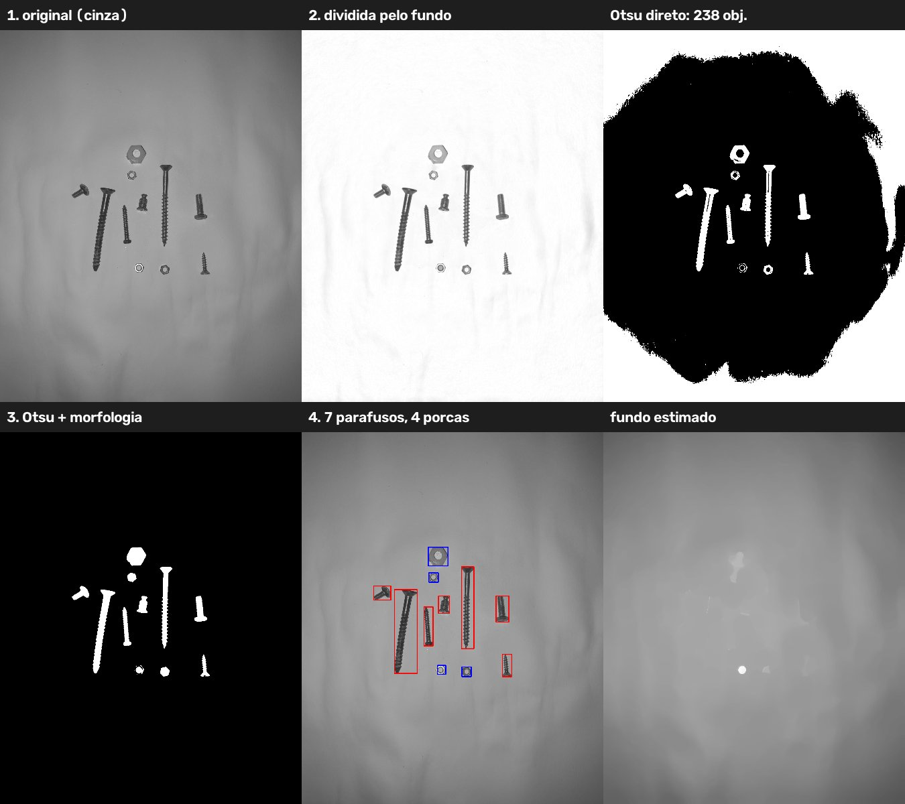
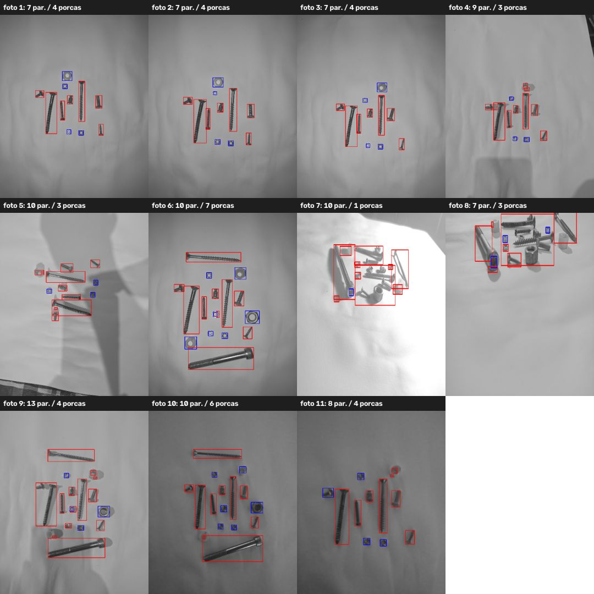

# Contagem de parafusos e porcas por visão computacional

Sistema que conta **quantos parafusos e quantas porcas** há numa foto de uma bancada, usando processamento digital de imagens clássico (OpenCV), sem deep learning. Pensado para inventário de peças em oficina, almoxarifado ou linha de montagem.

> *Counting screws and nuts on a workbench photo with classical image processing (OpenCV): background normalization, Otsu thresholding, morphology, connected components and shape-based classification, evaluated against manual counts on 11 photos under different lighting and camera angles.*

Projeto final (P2) da disciplina de Processamento Digital de Imagens (EC01039), Engenharia da Computação, UFC.



## Pipeline

```
cinza + redimensionar → suavizar (gaussiano 5×5) → dividir pelo fundo → limiar de Otsu (invertido)
→ abertura → fechamento → preencher furos → componentes conexos (N8) → filtro de área e de borda
→ classificar pela forma → contar
```

| Etapa | Por quê |
|---|---|
| **Dividir pelo fundo** | O flash deixa o centro claro e os cantos escuros (modelo f = i·r). O fundo é estimado com um fechamento de elemento estruturante grande, que apaga as peças finas, e a foto é dividida por ele. Com Otsu direto apareciam **238 objetos**; depois da divisão, 17. |
| **Abertura → fechamento** | A abertura tira ruído e textura do papel; o fechamento junta pedaços da peça que o brilho do metal separou. A ordem importa: fechar antes engorda o ruído e gruda nas peças. |
| **Preencher furos** | A porca aparece como anel. Preenchida, vira um hexágono cheio e a forma fica fácil de medir. |
| **Filtros** | Descarta componentes menores que 300 px (sujeira) e os que encostam na borda (mesa fora do papel, peça cortada). |
| **Classificação** | Porca = caixa quase quadrada (largura/altura entre 0,8 e 1,25) e ocupando ≥ 55% dela. O resto é parafuso. |

## Resultados

11 fotos com dois conjuntos de peças (7 parafusos + 4 porcas e 9 parafusos + 7 porcas), variando iluminação e ângulo, comparadas com a contagem manual ([`referencia_manual.csv`](referencia_manual.csv)).

| Foto | Condição | Parafusos (ref → sistema) | Porcas (ref → sistema) |
|---|---|---|---|
| 1 | luz ambiente + flash, de cima | 7 → 7 ✅ | 4 → 4 ✅ |
| 2 | luz ambiente + flash, de cima | 7 → 7 ✅ | 4 → 4 ✅ |
| 3 | luz ambiente + flash, de cima | 7 → 7 ✅ | 4 → 4 ✅ |
| 4 | luz ambiente, de cima | 7 → 9 | 4 → 3 |
| 5 | sombra da mão | 7 → 10 | 4 → 3 |
| 6 | luz ambiente + flash, de cima | 9 → 10 | 7 → 7 ✅ |
| 7 | luminária, inclinada | 9 → 10 | 7 → 1 |
| 8 | luz ambiente, bem inclinada | 9 → 7 | 7 → 3 |
| 9 | luz ambiente, sombra embaixo | 9 → 13 | 7 → 4 |
| 10 | pouca luz, de cima | 9 → 10 | 7 → 6 |
| 11 | pouca luz, desfocada | 7 → 8 | 4 → 4 ✅ |



Vermelho = parafuso, azul = porca.

### Onde o sistema falha

- **Porca de plástico branca sobre papel branco:** quase sem contraste. Só a borda ou a sombra aparece, quebra em pedaços compridos e vira "parafuso" (fotos 4, 9, 10, 11).
- **Sombra da mão (fotos 5 e 9):** a divisão pelo fundo não remove sombras grandes e escuras, que grudam nas peças.
- **Foto inclinada (fotos 7 e 8):** a sombra de cada peça gruda na vizinha, e a porca vista de lado deixa de ser hexágono.
- **Brilho do metal:** às vezes quebra uma peça em dois componentes (foto 6).
- **Parafuso curto de cabeça redonda:** caixa quase quadrada, pode ser confundido com porca (foto 11).

Com foto de cima e iluminação controlada o método acerta tudo. Fora disso, os erros mostram os limites de regras fixas de limiar e forma, e é o caso típico onde um detector treinado (ex.: YOLO) ou uma etapa de remoção de sombra resolveria.

## Como rodar

```bash
pip install -r requirements.txt

# uma foto
python contar.py fotos/Foto_1_parafuso_porca.jpg

# todas as fotos, comparando com a contagem manual e salvando as caixas desenhadas
python contar.py fotos/ --referencia referencia_manual.csv --saida resultados/
```

O passo a passo completo, com a máscara e os números de cada etapa, está no notebook [`PDI_P2_Parafusos_Porcas.ipynb`](PDI_P2_Parafusos_Porcas.ipynb).

## Estrutura

```
├── PDI_P2_Parafusos_Porcas.ipynb   # notebook com todas as etapas explicadas
├── contar.py                       # o mesmo pipeline como script de linha de comando
├── referencia_manual.csv           # contagem manual de cada foto (verdade)
├── fotos/                          # 11 fotos usadas na avaliação
└── docs/                           # imagens do README
```

## Tecnologias

Python · OpenCV · NumPy · Matplotlib
